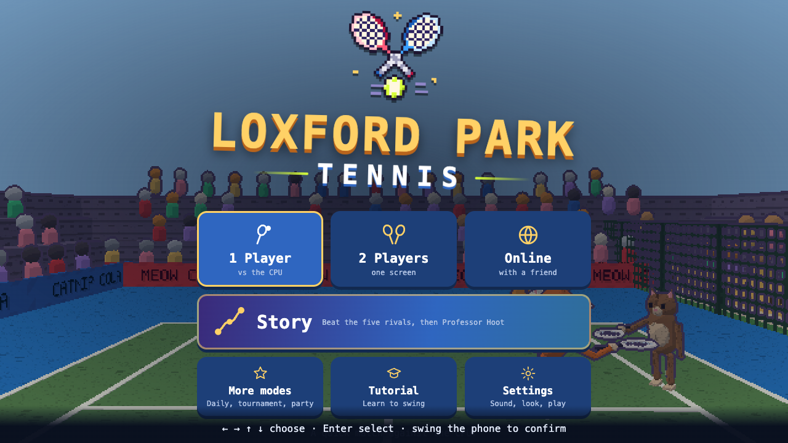
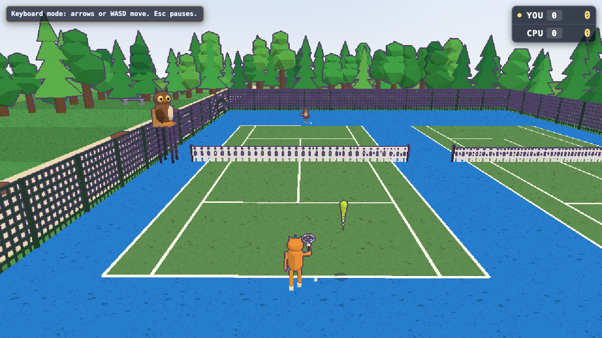
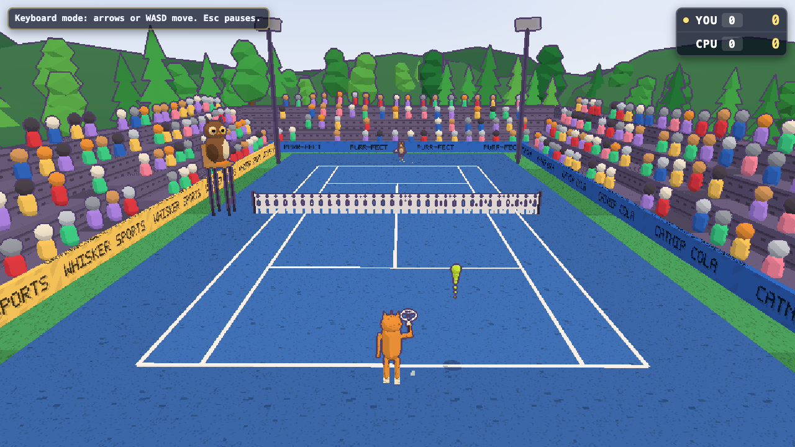
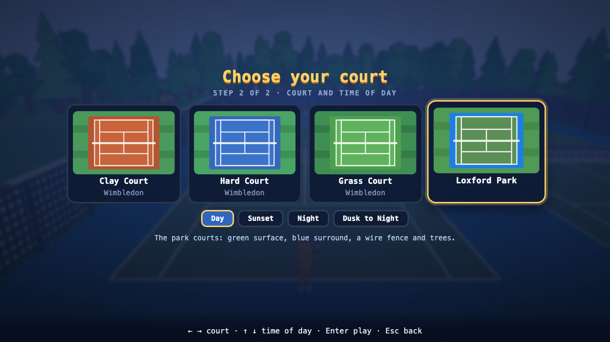

# Loxford Park Tennis

A 3D tennis game starring cats. Play it on your Mac with your **iPhone as the racket**: swing the phone and the cat swings. Beat the CPU, take on a friend on one screen or online, follow the story to Professor Hoot, or practise in the tutorial.



## Download (Mac)

**[Download the Mac app](https://github.com/CaptainKadir/Loxford-Park-Tennis/releases/latest)**: get `LoxfordParkTennis-mac-arm64.zip` from the latest release, unzip it and open **Loxford Park Tennis**.

- For Apple silicon Macs (M1 and later). Nothing else to install.
- **The first time, macOS says Apple could not verify the app.** It is not signed by an Apple Developer account. To open it anyway:
  1. Try to open the app, then click **Done** on the warning (not Move to Trash).
  2. Open **System Settings > Privacy & Security** and scroll down to the Security section.
  3. Next to "Loxford Park Tennis was blocked", click **Open Anyway** and enter your password.
  4. You only have to do this once. (Older macOS: right-click the app, choose Open.)
- Your iPhone is the racket. Your Mac and iPhone must be on the same Wi-Fi. In the game, scan the QR code under "Reconnect the phone" with the iPhone camera, open the link in Safari, tap **Start** (allow motion), hold the phone flat with its top pointing at the screen, and tap **Calibrate**.
- No phone? Move the cat with the arrow keys or WASD and press Enter to swing.

## What is in it

- **1 Player, 2 Players (one screen), Online with a friend**, and doubles.
- **Story mode** across six stops, ending with a boss match against Professor Hoot the owl. Daily challenges, tournaments, practice and party matches.
- Six cats to play as (and Professor Hoot once you finish the story), with a wardrobe of hats, headbands, rackets, ball trails and ball skins.
- Four courts: **Clay, Hard and Grass at Wimbledon**, and **Loxford Park**, the park courts. Day, sunset, night or dusk-to-night.

| Loxford Park | Wimbledon |
| --- | --- |
|  |  |



## Run from source

The portable game logic in `core/` (C) is compiled to WebAssembly and drives a browser game in `web/`. The iPhone's orientation moves the racket on screen and the swing decides the shot (forehand, backhand, topspin, slice, drop shot, lob; Settings > Shots picks Basic or All).

### One-time setup

1. `brew install emscripten node` (emscripten builds the WASM core).
2. `cd web && npm install`
3. Make a certificate (iPhone motion sensors need https): `sh web/scripts/make-cert.sh`. With `mkcert` installed it makes a trusted certificate (run `mkcert -install` once, then install `$(mkcert -CAROOT)/rootCA.pem` on the iPhone and enable it under Settings > General > About > Certificate Trust Settings). Without mkcert it makes a self-signed one: open the phone link in Safari once and accept the warning.

### Play

```
make -C web play
```

- Open `http://localhost:8080/` in Chrome on the Mac (add `?nophone` to play without pausing for the phone, e.g. to look at the graphics).
- Scan the QR code in the terminal (or open the printed `https://<mac-ip>:8443/pad`) in **Safari** on the iPhone. Tap **Start** (allow motion), hold the phone with its top pointing at the net, flat, and tap **Calibrate**.
- Move the cat with the arrow keys or WASD (it also runs to the ball by itself). Swing the phone to hit.
- The overlay shows samples per second and latency. Aim for under about 60 ms.

### Build the Mac app

`tools/macapp/build.sh` builds `dist/mac/Loxford Park Tennis.app` and a zip of it: a native window around the web game with Node bundled. The game starts its own server on a free port. Settings, the certificate and logs live in `~/Library/Application Support/Loxford Park Tennis/` (`server.log` is there if it will not start).

### Tests and tuning

```
make test           # C tests for core/ (physics, swing, shots)
make -C web test    # JavaScript tests (server, frame maths, session, renderer config)
```

Record swings with the **Record swings** button on the phone page. It saves a `.jsonl` file; convert and inspect it with:

```
node web/scripts/jsonl-to-csv.mjs swings.jsonl > swings.csv
make tools && build/host/replay_swing swings.csv
```

Each detected swing prints its racket speed, face angle, path and the shot it would be called. Shot thresholds are in `core/shot.h`.

## Licence

MIT, see `LICENSE`. Third-party assets keep their own licences (`docs/CREDITS.md`).
